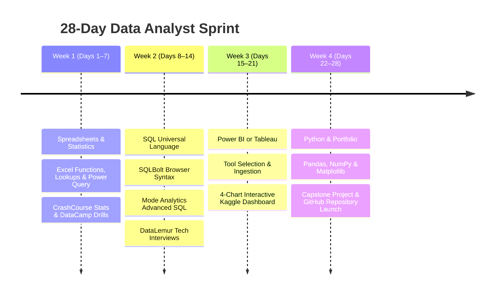

# 📈 Data Analyst Roadmap & Curated Resources (2026 Edition)

[⬅️ Return to Main Directory](../README.md)

A complete, structured curriculum and learning vault for aspiring and practicing **Data Analysts**. Includes an intensive 4-week fast-track sprint, essential toolchains, hands-on project ideas, and verified, direct search links to **free, high-yield YouTube tutorials, masterclasses, and playlists**.

---

## ⚡ 4-Week Intensive Sprint (Fast-Track Career Blueprint)

This 4-week intensive sprint focuses strictly on the most critical, employer-demanded skills needed to land a data analyst role or transition into the field. If you are on an expedited timeline, follow this structured week-by-week blueprint using top-tier, primarily free resources.

> [!TIP]
> **Pro-Tip for the 1-Month Timeline:**  
> Commit to **2–3 hours per day**. The biggest mistake beginners make is watching tutorials without doing the work. For every hour you watch, spend **two hours typing the code, writing queries, or building the dashboard yourself**.

---

### 🗓️ Week 1: Spreadsheets & Statistics (The Foundation) — Days 1–7

Excel is the backbone of business analytics. You need to master data cleaning, `VLOOKUP`/`XLOOKUP`, Pivot Tables, and fundamental statistical concepts.

- **Primary Goal:** Clean messy spreadsheets rapidly and compute summary statistics.
- **Key Concepts:** Data cleaning, formulas, keyboard shortcuts, Pivot Tables, summary metrics (mean, median, standard deviation), probability distributions, and hypothesis testing.
- **Top Curated Resources:**
  - 📗 **Excel Skills:** [Excel Is Fun (YouTube Channel)](https://www.youtube.com/user/ExcelIsFun) — Start with the *Excel for Data Analysts* playlist. It covers everything from basic formulas to Power Query.
  - 📊 **Statistics:** [CrashCourse Statistics (YouTube Playlist)](https://www.youtube.com/playlist?list=PL8dPuuaLjXtNM_Y-bUAhblSAdWRnmBUcr) — Focus on mean, median, standard deviation, probability, and hypothesis testing.
  - 💻 **Interactive Practice:** [DataCamp: Data Analysis in Excel](https://www.datacamp.com/courses/data-analysis-in-excel) (Free tier / audit) — Practice hands-on keyboard shortcuts and functions.

---

### 🗓️ Week 2: SQL (The Universal Data Language) — Days 8–14

SQL is the **#1 required technical skill** for data analysts. You must know how to extract, filter, join, and aggregate data directly from relational databases.

- **Primary Goal:** Query multi-table relational databases and solve business analysis problems.
- **Key Concepts:** `SELECT`, `WHERE`, `JOIN` (INNER, LEFT, RIGHT, FULL), `GROUP BY`, `HAVING`, Subqueries, Common Table Expressions (`WITH` CTEs), and Window Functions (`ROW_NUMBER`, `RANK`, `LEAD`, `LAG`).
- **Top Curated Resources:**
  - ⚡ **Interactive Learning:** [SQLBolt (Free)](https://sqlbolt.com/) — The absolute best way to learn syntax fast by writing queries directly in your browser.
  - 🔍 **Deep Dive:** [Mode Analytics SQL Tutorial (Free)](https://mode.com/sql-tutorial/) — Covers basic to advanced SQL (CTEs, Window Functions, and subqueries).
  - 🎯 **Interview Practice:** [DataLemur (Free Tier)](https://datalemur.com/) — Practice real SQL interview questions asked by top tech companies.

---

### 🗓️ Week 3: Power BI or Tableau (Data Visualization) — Days 15–21

You need one visualization tool to turn raw data into interactive dashboards. Choose **Power BI** if you use Windows (it's dominant in enterprise), or **Tableau** if you use a Mac.

- **Primary Goal:** Convert multi-table datasets into interactive, executive-ready dashboards.
- **Key Concepts:** Data ingestion, data relationships, calculated metrics (DAX / Calculated Fields), interactive filters/slicers, and layout hierarchy.
- **Top Curated Resources:**
  - 📊 **For Power BI:** [Kevin Stratvert: Power BI Tutorial (YouTube)](https://www.youtube.com/watch?v=TmhQCQr_DCA) or the official [Microsoft Learn Power BI Path](https://learn.microsoft.com/en-us/training/powerplatform/power-bi).
  - 📈 **For Tableau:** [Tableau Tim (YouTube Channel)](https://www.youtube.com/c/TableauTim) or Tableau's Free Training Videos on their official site.
  - 🛠️ **Hands-On Project Idea:** Find a free dataset on [Kaggle](https://www.kaggle.com/) (e.g., Netflix movies or Sales data) and build a **4-chart dashboard** featuring:
    1. High-level KPI summary cards (Total Revenue, Volume, Conversion).
    2. Time-series line chart tracking monthly/quarterly trends.
    3. Categorical breakdown bar or column chart.
    4. Dynamic interactive slicers and filters (Date range, Region, Category).

---

### 🗓️ Week 4: Python Fundamentals & Portfolio Building — Days 22–28

You don't need to be a software engineer, but you need to know how to use Python's core data libraries (Pandas, NumPy, and Matplotlib) to clean, transform, and visualize large datasets.

- **Primary Goal:** Build an end-to-end analytics workflow in Python and publish a resume-defining project.
- **Key Concepts:** Python data structures, Pandas DataFrames, indexing, filtering, missing value imputation, group aggregations, and matplotlib/seaborn visualization.
- **Top Curated Resources:**
  - 🐍 **Python Basics:** [Programming with Mosh: Python for Beginners (YouTube)](https://www.youtube.com/watch?v=_uQrJ0TkZlc) — Clean, intuitive introduction to Python syntax.
  - 🐼 **Data Analysis in Python:** [Alex The Analyst: Python Bootcamp (YouTube Playlist)](https://www.youtube.com/playlist?list=PLUaB-1hjhk8FE_XZ87vPPSfHqb6OcM0cF) — Excellent breakdown of Pandas and data manipulation.
  - 🏆 **The Capstone Project (Your Resume Centerpiece):** Bring it all together!
    1. Download a raw dataset from [Kaggle](https://www.kaggle.com/).
    2. Clean and preprocess it using Python (Pandas) or SQL.
    3. Visualize it in Power BI or Tableau.
    4. Publish the documented code, insights, and dashboard screenshots to a free GitHub repository. This single project becomes your resume centerpiece.

---

## 🌟 Top YouTube Channels Quick Directory

Bookmark these verified channels for direct learning:

- [📺 **freeCodeCamp.org**](https://www.youtube.com/@freecodecamp) — Complete, ad-free multi-hour courses on Python, SQL, Excel, and Spark.
- [📺 **Luke Barousse**](https://www.youtube.com/@LukeBarousse) — Practical SQL, Python, Power BI tutorials, and career portfolio advice.
- [📺 **Alex The Analyst**](https://www.youtube.com/@AlexTheAnalyst) — Practical beginner-to-advanced roadmaps, SQL, Python bootcamps, and portfolio guidance.
- [📺 **StatQuest with Josh Starmer**](https://www.youtube.com/@statquest) — Visual, step-by-step breakdowns of statistics, probability, and machine learning.
- [📺 **ExcelIsFun (Mike Girvin)**](https://www.youtube.com/@ExcelIsFun) — Comprehensive Excel tutorials, formulas, Power Query, and business analytics.
- [📺 **Tableau Tim**](https://www.youtube.com/@TableauTim) — Clear, modular tutorials covering all Tableau products, features, and best practices.
- [📺 **Keith Galli**](https://www.youtube.com/@KeithGalli) — Hands-on real-world Pandas, Web Scraping, and Python data problem solving.
- [📺 **Corey Schafer**](https://www.youtube.com/@coreyms) — Thorough, clean software engineering practices in Python, Pandas, and scripting.
- [📺 **Programming with Mosh**](https://www.youtube.com/@programmingwithmosh) — Concise, beginner-friendly programming bootcamps and Python fundamentals.
- [📺 **Krish Naik**](https://www.youtube.com/@krishnaik06) — Deep-dive statistics, machine learning, and PySpark courses.
- [📺 **CampusX (Nitish Singh)**](https://www.youtube.com/@CampusX-official) — Exceptional 100 Days of Machine Learning and EDA series.
- [📺 **Leila Gharani**](https://www.youtube.com/@LeilaGharani) — Advanced modern Excel formulas, dashboards, and productivity hacks.
- [📺 **Chandoo**](https://www.youtube.com/@chandoo_) — Excel dashboards, pivot tables, and business reporting.
- [📺 **3Blue1Brown**](https://www.youtube.com/@3blue1brown) — The most intuitive mathematical and geometric visualizations available.
- [📺 **Ken Jee**](https://www.youtube.com/@KenJee_ds) — Practical data portfolio projects, workflow tips, and career guidance.

---

[⬅️ Return to Main Directory](../README.md)
