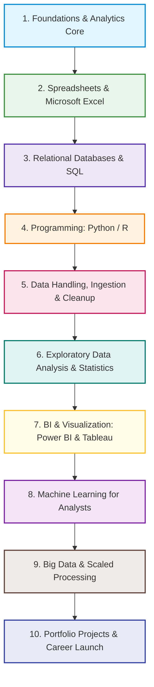

# 📈 Data Analyst Roadmap & Curated Resources (2026 Edition)

[⬅️ Return to Main Directory](../README.md)

A complete, structured curriculum and learning vault for aspiring and practicing **Data Analysts**, organized according to the industry-standard [roadmap.sh Data Analyst Roadmap](https://roadmap.sh/data-analyst). Each stage contains deep conceptual breakdowns, essential toolchains, hands-on project ideas, and handpicked **free, high-yield YouTube tutorials and playlists**.

---

## 🧭 Visual Roadmap Overview

---

## 📑 Table of Contents

1. [Stage 1: Introduction & Key Concepts of Data Analytics](#stage-1-introduction--key-concepts-of-data-analytics)
2. [Stage 2: Spreadsheets — Excel Mastery](#stage-2-spreadsheets--excel-mastery)
3. [Stage 3: Structured Query Language (SQL)](#stage-3-structured-query-language-sql)
4. [Stage 4: Programming — Python for Data Analysis](#stage-4-programming--python-for-data-analysis)
5. [Stage 5: Data Gathering, Ingestion & Cleanup](#stage-5-data-gathering-ingestion--cleanup)
6. [Stage 6: Statistical Analysis & Exploratory Data Analysis (EDA)](#stage-6-statistical-analysis--exploratory-data-analysis-eda)
7. [Stage 7: Business Intelligence & Data Visualization (Power BI & Tableau)](#stage-7-business-intelligence--data-visualization-power-bi--tableau)
8. [Stage 8: Machine Learning for Analysts](#stage-8-machine-learning-for-analysts)
9. [Stage 9: Big Data Technologies (Spark, Hadoop & Scaled Analytics)](#stage-9-big-data-technologies-spark-hadoop--scaled-analytics)
10. [Stage 10: Deep Learning Fundamentals (Optional Track)](#stage-10-deep-learning-fundamentals-optional-track)
11. [Stage 11: Real-World Portfolio Projects & Career Launch](#stage-11-real-world-portfolio-projects--career-launch)
12. [Top YouTube Channels Quick Directory](#top-youtube-channels-quick-directory)

---

## Stage 1: Introduction & Key Concepts of Data Analytics

Before diving into code and tools, build an intuitive mental model of the analytics life cycle and business questions.

### 🔑 Core Concepts
- **Data Life Cycle:** Collection $\rightarrow$ Cleanup $\rightarrow$ Exploration $\rightarrow$ Visualization $\rightarrow$ Statistical Modeling $\rightarrow$ Business Storytelling.
- **The Four Analytics Archetypes:**
  - **Descriptive Analytics:** *What happened?* (e.g., Monthly revenue reports, KPI tracking).
  - **Diagnostic Analytics:** *Why did it happen?* (e.g., Churn drill-downs, root cause analysis).
  - **Predictive Analytics:** *What is likely to happen?* (e.g., Demand forecasting, customer churn likelihood).
  - **Prescriptive Analytics:** *What action should we take?* (e.g., Dynamic pricing engines, supply chain routing).

### 📺 Best YouTube Resources & Playlists
| Resource / Playlist | Channel / Instructor | Focus Area |
| :--- | :--- | :--- |
| [Data Analyst Roadmap & Career Guidance](https://www.youtube.com/playlist?list=PLUaB-1hjhk8GUKn82ftS7quU5-pLzHk1c) | **Alex The Analyst** | Complete roadmap, daily workflow, and career transition guide |
| [How to Become a Data Analyst](https://www.youtube.com/@LukeBarousse) | **Luke Barousse** | Tech stack comparisons, market demand, and day-in-the-life insights |
| [What Does a Data Analyst Actually Do?](https://www.youtube.com/watch?v=PSNXoAs28Ag) | **freeCodeCamp.org** | End-to-end overview of analyst workflows and toolsets |

---

## Stage 2: Spreadsheets — Excel Mastery

Excel remains the most widely deployed analytics tool worldwide. Modern analysts must go far beyond basic tables to master lookups, logic, aggregation, and interactive dashboards.

### 🔑 Skills & Functions Checklist
- **Lookup & Reference:** `XLOOKUP` (preferred modern standard), `VLOOKUP`, `HLOOKUP`, `INDEX` + `MATCH`.
- **Logical & Conditional:** `IF`, `IFS`, `AND`, `OR`, `IFERROR`, `COUNTIF`, `SUMIF`, `AVERAGEIF`.
- **Text & Transformation:** `CONCAT`, `TEXTJOIN`, `TRIM`, `UPPER`, `LOWER`, `PROPER`, `REPLACE`, `SUBSTITUTE`.
- **Date & Time:** `DATEDIF`, `YEAR`, `MONTH`, `NETWORKDAYS`, `EOMONTH`.
- **Analytics & Presentation:** Pivot Tables, Calculated Fields, Slicers, Conditional Formatting, Dynamic Charting (Bar, Scatter, Waterfall, Pareto).

### 📺 Best YouTube Resources & Playlists
| Resource / Playlist | Channel / Instructor | Focus Area |
| :--- | :--- | :--- |
| [Excel for Beginners to Advanced](https://www.youtube.com/playlist?list=PLUaB-1hjhk8HYZg5pM87j5NnMs4tX9i85) | **Alex The Analyst** | Targeted specifically for aspiring Data Analysts (Functions, Pivots, Dashboards) |
| [Microsoft Excel Tutorial for Beginners (Full Course)](https://www.youtube.com/watch?v=Vl0H-qTclOg) | **freeCodeCamp.org** | 6 practical real-world project walkthroughs from scratch |
| [Excel Formulas & Functions Masterclass](https://www.youtube.com/@LeilaGharani) | **Leila Gharani** | Industry-standard tips, modern `XLOOKUP`, `LAMBDA`, and dynamic arrays |
| [Excel Dashboards & Analytics](https://www.youtube.com/@chandoo_) | **Chandoo** | Designing executive dashboards, KPI cards, and automated reporting |

---

## Stage 3: Structured Query Language (SQL)

SQL is non-negotiable. Analysts use SQL daily to extract, filter, join, clean, and aggregate multi-million-row database tables.

### 🔑 SQL Core Curriculum
- **Foundational Operations:** `SELECT`, `WHERE`, `ORDER BY`, `DISTINCT`, `LIMIT` / `TOP`.
- **Aggregations & Grouping:** `GROUP BY`, `HAVING`, `SUM`, `AVG`, `COUNT`, `MIN`, `MAX`.
- **Joins & Set Theory:** `INNER JOIN`, `LEFT JOIN`, `RIGHT JOIN`, `FULL OUTER JOIN`, `CROSS JOIN`, `UNION` vs `UNION ALL`.
- **Advanced Querying (Crucial for Interviews):**
  - **Window Functions:** `ROW_NUMBER()`, `RANK()`, `DENSE_RANK()`, `LEAD()`, `LAG()`, `NTILE()`, running sums with `OVER(PARTITION BY ... ORDER BY ...)`.
  - **Subqueries & CTEs:** Common Table Expressions (`WITH cte AS (...)`), nested subqueries, correlated subqueries.
  - **Data Manipulation (DML/DDL):** `CREATE TABLE`, `INSERT`, `UPDATE`, `CASE WHEN ... THEN ... ELSE END`, `COALESCE`, `CAST` / data type conversion.

### 📺 Best YouTube Resources & Playlists
| Resource / Playlist | Channel / Instructor | Focus Area |
| :--- | :--- | :--- |
| [SQL for Beginners & Intermediate Series](https://www.youtube.com/playlist?list=PLUaB-1hjhk8H48Pj32z4GZgGWyylqv85f) | **Alex The Analyst** | Comprehensive SQL series using MySQL & SQL Server (Basics to Window Functions) |
| [SQL for Data Analytics — Full Course](https://www.youtube.com/watch?v=7mz73uXD9DA) | **Luke Barousse** | Practical PostgreSQL / MySQL tutorials built around real job posting data |
| [SQL Tutorial — Full Database Course for Beginners](https://www.youtube.com/watch?v=HXV3zeQKqGY) | **freeCodeCamp.org** (Mike Dane) | Complete foundational relational database design and SQL querying |
| [Relational Database Design Course](https://www.youtube.com/watch?v=ztHopE5Wnpc) | **freeCodeCamp.org** (Caleb Curry) | Primary keys, foreign keys, normalization (1NF, 2NF, 3NF), and entity relationships |

---

## Stage 4: Programming — Python for Data Analysis

Python is the standard language for modern data analytics, enabling automation, advanced statistics, and seamless end-to-end pipelines. *(Note: R with `tidyverse` and `ggplot2` is an alternate track in academia/biotech).*

### 🔑 Python Toolkit
- **Language Fundamentals:** Data structures (lists, dicts, sets, tuples), loops, list comprehensions, functions, exception handling.
- **NumPy:** Multi-dimensional arrays (`ndarray`), vectorized operations, mathematical functions, linear algebra basics.
- **Pandas:**
  - `DataFrame` & `Series` manipulation.
  - Reading/Writing formats (`read_csv`, `read_excel`, `read_sql`, `read_json`, `to_parquet`).
  - Indexing & slicing (`loc`, `iloc`), boolean masking.
  - Grouping and pivoting (`groupby`, `agg`, `pivot_table`, `melt`).
  - Merging and concatenating (`merge`, `concat`, `join`).
  - Handling date/time series (`pd.to_datetime`, resample).

### 📺 Best YouTube Resources & Playlists
| Resource / Playlist | Channel / Instructor | Focus Area |
| :--- | :--- | :--- |
| [Python for Beginners to Data Analysts](https://www.youtube.com/playlist?list=PLUaB-1hjhk8GUKn82ftS7quU5-pLzHk1c) | **Alex The Analyst** | Practical Python course curated exclusively for data analysts |
| [Data Analysis with Python Course](https://www.youtube.com/watch?v=r-uOLxNrNk8) | **freeCodeCamp.org** | 10+ hour comprehensive course on NumPy, Pandas, Matplotlib, and Seaborn |
| [Complete Python Pandas Data Science Tutorial](https://www.youtube.com/watch?v=vmEHCJofslg) | **Keith Galli** | Real-world dataset walk-through covering filtering, sorting, aggregations |
| [Python Pandas Playlist](https://www.youtube.com/playlist?list=PL-osiE80TeTsWmV9i9c58mdDCSskIFdDS) | **Corey Schafer** | Deep dive into Pandas internals, custom apply functions, and best practices |
| [Python for Data Analytics Full Course](https://www.youtube.com/watch?v=wUSDVGivd-8) | **Luke Barousse** | Practical environment setup (VS Code, Google Colab) and guided analysis project |

---

## Stage 5: Data Gathering, Ingestion & Cleanup

Real-world data is messy, incomplete, and distributed across disparate sources. Analysts spend ~70% of their time here.

### 🔑 Ingestion & Cleaning Checklist
- **Ingestion Channels:**
  - Flat files (`.csv`, `.tsv`, `.xlsx`, `.parquet`).
  - Web Scraping: Automated scraping with **BeautifulSoup** and **Requests**; dynamic JS scraping with **Selenium** or **Playwright**.
  - REST APIs: Querying endpoints, authenticating with API tokens, paginating results, parsing nested JSON.
  - Relational & NoSQL Databases: Connecting via `SQLAlchemy`, `psycopg2`, `pymysql`.
- **Data Cleansing Pipelines:**
  - **Missing Data:** Assessing patterns (MCAR, MAR, MNAR), imputing (mean, median, forward fill, KNN), or prudent dropping.
  - **Duplicates:** Identifying subset-based duplicates (`drop_duplicates`), deduplication heuristics.
  - **Outliers:** Detection via Interquartile Range ($IQR$), $Z$-score, Box plots; capping vs trimming.
  - **Transformations:** Type casting, string cleaning (`strip`, regex replacement), one-hot encoding, date parsing, column scaling/standardization.

### 📺 Best YouTube Resources & Playlists
| Resource / Playlist | Channel / Instructor | Focus Area |
| :--- | :--- | :--- |
| [Data Cleaning in SQL & Pandas Walkthrough](https://www.youtube.com/playlist?list=PLUaB-1hjhk8FE_XZ87vPPSfHqb6OcM0cF) | **Alex The Analyst** | Hands-on data cleaning project solving real data corruption issues |
| [Web Scraping Real-World Data with BeautifulSoup](https://www.youtube.com/watch?v=GjKQ6V_ViQE) | **Keith Galli** | End-to-end movie dataset extraction and API metadata enrichment |
| [Python Web Scraping & Requests](https://www.youtube.com/playlist?list=PL-osiE80TeTt2d9bfVyTiXJA-UTHn6WwU) | **Corey Schafer** | Scraping static & dynamic HTML, extracting tables, and parsing payloads |

---

## Stage 6: Statistical Analysis & Exploratory Data Analysis (EDA)

Statistics transforms raw data into reliable business conclusions, preventing spurious correlations and misleading deductions.

### 🔑 Statistical Toolkit
- **Descriptive Statistics:**
  - Measures of Central Tendency: Mean, Median, Mode (when to use which based on skew).
  - Measures of Dispersion: Range, Variance ($\sigma^2$), Standard Deviation ($\sigma$), Interquartile Range ($IQR$).
  - Distribution Shapes: Normal Distribution, Skewness (positive vs. negative), Kurtosis, Central Limit Theorem ($CLT$).
- **Inferential Statistics & Hypothesis Testing:**
  - Null Hypothesis ($H_0$) vs. Alternative Hypothesis ($H_1$).
  - $p$-values, Type I ($\alpha$) and Type II ($\beta$) errors, Confidence Intervals ($95\%$).
  - Statistical Tests: Student's $t$-test (independent and paired), ANOVA (comparing multiple groups), Chi-Square ($\chi^2$) test for categorical independence.
  - Correlation & Association: Pearson correlation ($r$), Spearman rank correlation, Causation vs. Correlation pitfalls.
- **Regression Analysis:** Simple & Multiple Linear Regression, Residual analysis, $R^2$ and Adjusted $R^2$.

### 📺 Best YouTube Resources & Playlists
| Resource / Playlist | Channel / Instructor | Focus Area |
| :--- | :--- | :--- |
| [Statistics Fundamentals Playlist](https://www.youtube.com/playlist?list=PLblh5JKOoLUK0FLuzwntyYI10UQFUhsY9) | **StatQuest (Josh Starmer)** | The gold standard for visual, intuitive explanations of p-values, distributions, and testing |
| [Complete Statistics for Data Science (6-Hour Masterclass)](https://www.youtube.com/watch?v=LZ_CiXvCVw0) | **Krish Naik** | Descriptive, inferential, sampling, probability, and Python statistical testing |
| [Statistics and Probability Course](https://www.youtube.com/@khanacademy) | **Khan Academy** | Rigorous foundational math, random variables, normal distributions, and hypothesis tests |
| [Essence of Linear Algebra](https://www.youtube.com/playlist?list=PLZHQObOWTQDPD3MizzM2xVFitgF8hE_ab) | **3Blue1Brown** | Geometric intuition for vectors, matrices, dot products, and transformations |

---

## Stage 7: Business Intelligence & Data Visualization (Power BI & Tableau)

The ability to translate complex queries into intuitive, self-serve dashboards is what stakeholders value most.

### 🔑 Visualization & BI Competencies
- **Visual Encoding Best Practices:**
  - Choosing chart types: Bars (comparisons), Line (trends over time), Scatter (relationships), Histograms (distributions), Heatmaps (cross-dimensional density), Funnels (conversion pipelines).
  - Avoiding chart junk (e.g., unnecessary 3D charts, pie charts with $>4$ slices).
- **Microsoft Power BI:**
  - Power Query (M code, ETL, shaping).
  - Data Modeling: Star Schema vs. Snowflake, relationships ($1:N$, $N:M$), active vs. inactive relationships.
  - **DAX (Data Analysis Expressions):** Calculated columns vs Measures, `CALCULATE`, `ALL`, `FILTER`, `RELATED`, Time Intelligence (`YTD`, `SAMEPERIODLASTYEAR`).
  - Power BI Service: Workspaces, automated refreshes, role-level security (RLS).
- **Tableau:**
  - Dimensions vs. Measures, Discrete (blue) vs. Continuous (green).
  - Calculated Fields, Parameters, Table Calculations.
  - Level of Detail (**LOD**) Expressions: `FIXED`, `INCLUDE`, `EXCLUDE`.
  - Interactive Dashboards & Story points.

### 📺 Best YouTube Resources & Playlists
| Resource / Playlist | Channel / Instructor | Focus Area |
| :--- | :--- | :--- |
| [Power BI Full Course / Series](https://www.youtube.com/playlist?list=PLUaB-1hjhk8Gx33Wp2_Yg_jKjB797hD5m) | **Alex The Analyst** | Step-by-step Power BI Desktop, DAX formulas, and full dashboard builds |
| [Power BI for Beginners Full Course](https://www.youtube.com/watch?v=AGrl-H87pRU) | **Luke Barousse** | Practical Power BI dashboard project with real datasets and portfolio hosting |
| [Tableau Full Course for Beginners](https://www.youtube.com/playlist?list=PLUaB-1hjhk8GwbqCGk9L9cxkffzV44U2A) | **Alex The Analyst** | Complete Tableau series from basic visualizations to published dashboards |
| [Tableau for Data Science & Visualization](https://www.youtube.com/watch?v=TPvlqU_O26U) | **freeCodeCamp.org** | Quick crash course on connecting databases and building dashboards |
| [Power BI Beginner to Pro Tutorial](https://www.youtube.com/@KevinStratvert) | **Kevin Stratvert** | Clear, clean introductory walkthrough of Power BI Desktop |

---

## Stage 8: Machine Learning for Analysts

Data analysts frequently apply foundational ML algorithms for predictive insights, segmentation, and automated grouping without needing full ML engineering infrastructure.

### 🔑 Essential ML Algorithms
- **Supervised Learning (Regression & Classification):**
  - **Linear Regression:** Predicting continuous values (sales, prices).
  - **Logistic Regression:** Binary classification (churn/retention, fraud yes/no).
  - **Decision Trees & Random Forests:** Non-linear decision rules, feature importance.
  - **K-Nearest Neighbors ($KNN$):** Distance-based classification.
  - **Naive Bayes:** Probabilistic text/categorical classification.
- **Unsupervised Learning:**
  - **K-Means Clustering:** Customer segmentation, grouping behavioral cohorts.
  - **Principal Component Analysis ($PCA$):** Dimensionality reduction and variance breakdown.
- **Model Evaluation Metrics:**
  - Classification: Confusion Matrix, Accuracy, Precision, Recall, $F_1$-Score, ROC-AUC curve.
  - Regression: Mean Absolute Error ($MAE$), Mean Squared Error ($MSE$), Root Mean Squared Error ($RMSE$).

### 📺 Best YouTube Resources & Playlists
| Resource / Playlist | Channel / Instructor | Focus Area |
| :--- | :--- | :--- |
| [Machine Learning Playlist](https://www.youtube.com/playlist?list=PLblh5JKOoLUICTaGLRoHQDuF_7q2GfuJF) | **StatQuest (Josh Starmer)** | Visual breakdowns of Decision Trees, Random Forests, Logistic Regression, ROC/AUC |
| [100 Days of Machine Learning](https://www.youtube.com/playlist?list=PLKnIA16_Rmvbr7zKYQuBfsVkAQKEcJ944) | **CampusX (Nitish Singh)** | Exhaustive, practical Hindi/English series with Python implementations and feature engineering |
| [Machine Learning for Everybody](https://www.youtube.com/watch?v=i_LwzRVP7bg) | **freeCodeCamp.org** | Hands-on scikit-learn implementations and model evaluation techniques |
| [Complete Machine Learning Playlist](https://www.youtube.com/playlist?list=PLZoTAELRMXVPBTrWtJkn3wTQxZSvCcSz-) | **Krish Naik** | End-to-end algorithms, mathematical derivations, and Python code |

---

## Stage 9: Big Data Technologies (Spark, Hadoop & Scaled Analytics)

When datasets exceed single-machine RAM limits (gigabytes to terabytes), enterprise analytics leverages distributed computing clusters.

### 🔑 Big Data Core
- **Big Data Characteristics:** Volume, Velocity, Variety, Veracity, Value.
- **Hadoop Ecosystem:** HDFS (Hadoop Distributed File System), MapReduce paradigm, YARN.
- **Apache Spark & PySpark:**
  - Spark Architecture: Driver, Cluster Manager, Worker Nodes, Resilient Distributed Datasets (RDDs).
  - **PySpark DataFrames & Spark SQL:** Distributed transformations (`select`, `filter`, `groupBy`) and actions (`collect`, `count`).
  - Lazy Evaluation & DAG (Directed Acyclic Graph) optimization.
  - Cloud Data Warehouses & Lakehouses: Snowflake, Google BigQuery, Databricks, Amazon Redshift.

### 📺 Best YouTube Resources & Playlists
| Resource / Playlist | Channel / Instructor | Focus Area |
| :--- | :--- | :--- |
| [PySpark Tutorial for Beginners](https://www.youtube.com/watch?v=_C8kWso4ne4) | **freeCodeCamp.org** (Krish Naik) | Hands-on PySpark DataFrame operations, MLlib, and Databricks integration |
| [Apache Spark with Python (PySpark) Playlist](https://www.youtube.com/@krishnaik06) | **Krish Naik** | Cluster operations, Spark architecture, transformations, and actions |
| [Big Data & Hadoop Full Course](https://www.youtube.com/@edurekaIN) | **edureka!** | Distributed systems theory, HDFS, MapReduce, and ecosystem architecture |

---

## Stage 10: Deep Learning Fundamentals (Optional Track)

While deep learning is predominantly the domain of ML Engineers and Data Scientists, having a conceptual grasp helps analysts collaborate effectively with AI/ML teams.

### 🔑 Core Concepts
- Artificial Neural Networks (ANN): Perceptrons, activation functions (ReLU, Sigmoid, Softmax), forward propagation, backpropagation, gradient descent.
- Specialized Architectures:
  - **CNN (Convolutional Neural Networks):** Image recognition, spatial pattern extraction.
  - **RNN / Transformers:** Sequential data, time series forecasting, natural language processing (NLP).
- Leading Frameworks: **PyTorch** & **TensorFlow**.

### 📺 Best YouTube Resources & Playlists
| Resource / Playlist | Channel / Instructor | Focus Area |
| :--- | :--- | :--- |
| [Neural Networks Masterclass](https://www.youtube.com/playlist?list=PLZHQObOWTQDNU6R1_67000Dx_ZCJB-3pi) | **3Blue1Brown** | Unmatched visual intuition for neural network mechanics and backpropagation |
| [Deep Learning Specialization Playlists](https://www.youtube.com/@Deeplearningai) | **DeepLearning.AI (Andrew Ng)** | Foundational concepts taught by one of AI's pioneer educators |
| [PyTorch for Deep Learning Bootcamp](https://www.youtube.com/watch?v=V_xro1bcAuA) | **freeCodeCamp.org** | Hands-on coding of neural network models from scratch |

---

## Stage 11: Real-World Portfolio Projects & Career Launch

A stellar GitHub portfolio with clean documentation, reproducible code, and business-focused storytelling is your #1 asset when landing interviews.

### 💼 Recommended Project Archetypes
1. **End-to-End Sales Performance & Revenue Intelligence Dashboard**
   - *Tools:* SQL (data extraction & cleaning), Power BI or Tableau (interactive executive dashboard).
   - *Focus:* Year-over-year revenue, product-level profit margins, regional trends, customer cohort breakdown.
2. **Customer Segmentation & RFM Analysis**
   - *Tools:* Python (Pandas, Scikit-Learn K-Means), Seaborn.
   - *Focus:* Recency, Frequency, Monetary (RFM) clustering to identify high-value vs. churn-risk customers.
3. **Automated Web Scraping & Market Price Tracker**
   - *Tools:* Python (BeautifulSoup, Requests, Pandas, SQLite).
   - *Focus:* Scraping competitive e-commerce or job board pricing, scheduling updates, visualizing market shifts.
4. **Predictive Churn / Retention Analysis**
   - *Tools:* Python (Logistic Regression, Random Forest, Scikit-Learn evaluation).
   - *Focus:* Identifying primary churn drivers and prescribing actionable customer success interventions.

### 📺 Best YouTube Resources & Playlists
| Resource / Playlist | Channel / Instructor | Focus Area |
| :--- | :--- | :--- |
| [Full Data Analyst Portfolio Project Series](https://www.youtube.com/playlist?list=PLUaB-1hxwh8E9vQ56L0Yn-n-8cM0sZ6G5) | **Alex The Analyst** | Complete 4-part series covering SQL exploration, cleaning, Tableau viz, and GitHub presentation |
| [How to Build a Data Analyst Portfolio from Scratch](https://www.youtube.com/@LukeBarousse) | **Luke Barousse** | GitHub README optimization, project selection, and recruiter presentation |
| [Data Science / Analyst Projects from Scratch](https://www.youtube.com/@KenJee_ds) | **Ken Jee** | Project ideation, storytelling, and avoiding cookie-cutter repository mistakes |

---

## 🌟 Top YouTube Channels Quick Directory

Bookmark these channels for continuous learning:

- [📺 **Alex The Analyst**](https://www.youtube.com/@AlexTheAnalyst) — Best all-around channel for practical analyst bootcamps, SQL, Excel, Tableau, Power BI, and portfolio projects.
- [📺 **Luke Barousse**](https://www.youtube.com/@LukeBarousse) — Superb visuals, SQL/Python/Power BI courses, and career navigation advice.
- [📺 **freeCodeCamp.org**](https://www.youtube.com/@freecodecamp) — In-depth, 4-to-12 hour ad-free complete masterclasses on Python, SQL, Excel, and Spark.
- [📺 **StatQuest with Josh Starmer**](https://www.youtube.com/@statquest) — Unrivaled visual breakdowns of statistics, probability, and machine learning concepts.
- [📺 **Keith Galli**](https://www.youtube.com/@KeithGalli) — Hands-on real-world Pandas, Web Scraping, and Python data problem solving.
- [📺 **Corey Schafer**](https://www.youtube.com/@coreyms) — Thorough, clean software engineering practices in Python, Pandas, and scripting.
- [📺 **Krish Naik**](https://www.youtube.com/@krishnaik06) — Deep-dive statistics, machine learning, and PySpark courses.
- [📺 **CampusX (Nitish Singh)**](https://www.youtube.com/@CampusX-official) — Exceptional 100 Days of Machine Learning and EDA series.
- [📺 **Leila Gharani**](https://www.youtube.com/@LeilaGharani) — Advanced modern Excel formulas, dashboards, and productivity hacks.
- [📺 **3Blue1Brown**](https://www.youtube.com/@3blue1brown) — The most intuitive mathematical and geometric visualizations available on the internet.

---

[⬅️ Return to Main Directory](../README.md)
