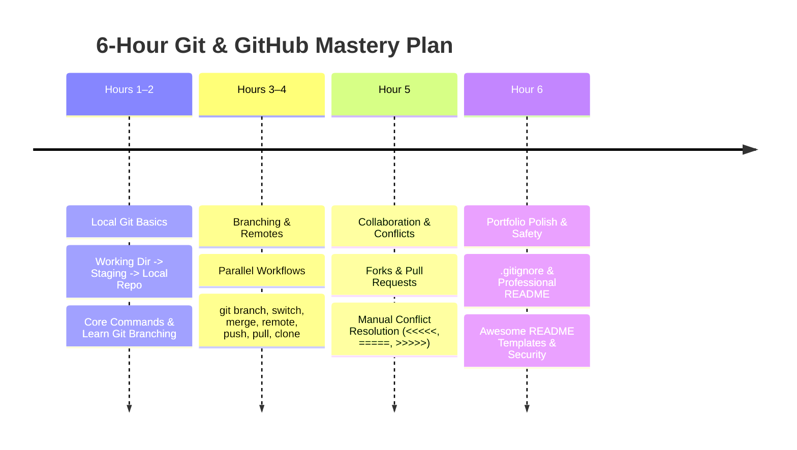

# 🚀 6-Hour Git & GitHub Mastery Blueprint

[⬅️ Return to Main Directory](../README.md)

[](https://www.youtube.com/@dhruvnarayanraina)
[](#-6-hour-study-schedule)
[](https://learngitbranching.js.org/)
[](https://skills.github.com/)
[](../LICENSE)

A structured, zero-fluff, hands-on plan engineered to take you from initial repository setup to collaborating with pull requests, resolving merge conflicts, and publishing a clean developer portfolio in **6 focused hours**.

---

## 🧭 The 6-Hour Study Schedule



---

### ⏱️ Hour 1–2: Local Git Basics

**Focus:** Understanding the fundamental 3-stage architecture of Git: **Working Directory $\rightarrow$ Staging Area $\rightarrow$ Local Repository**.

```
[ Working Directory ]  --- git add <file> --->  [ Staging Area (Index) ]  --- git commit -m --->  [ Local Repository (.git) ]
```

- **Core Concepts:**
  - Initializing local version control without touching the network.
  - Tracking file states: Untracked, Modified, Staged, and Committed.
  - Inspecting your project commit history and file diffs.
- **Essential Commands:**
  - `git init` — Initialize an empty Git repository locally.
  - `git status` — Inspect modified, untracked, and staged files.
  - `git add <file>` / `git add .` — Move files from working directory to staging index.
  - `git commit -m "feat: descriptive commit message"` — Snapshot staged changes into history.
  - `git log --oneline --graph --decorate` — Visualize commit tree history compactly.
  - `git diff` — View unstaged changes; use `git diff --staged` for staged differences.
- **Hands-On Interactive Tool:**
  - 🎮 [Learn Git Branching](https://learngitbranching.js.org/) — Complete **Main: Introduction Sequence (Levels 1–4)**.

---

### ⏱️ Hour 3–4: Branching & GitHub Remotes

**Focus:** Non-linear development, parallel feature workflows, and syncing local commits with cloud remotes (GitHub).

- **Core Concepts:**
  - Creating isolated feature branches to keep the `main` branch production-ready.
  - Fast-forward vs. 3-way recursive merge mechanics.
  - Linking your local `.git` repository to a remote GitHub URL.
- **Essential Commands:**
  - `git branch` — List existing local branches.
  - `git branch <branch-name>` — Create a new branch pointer.
  - `git switch <branch-name>` (or `git checkout <branch-name>`) — Switch working branch.
  - `git switch -c <branch-name>` — Create and switch to a branch in one step.
  - `git merge <branch-name>` — Integrate the specified branch's commits into the currently active branch.
  - `git remote add origin <url>` — Connect local repo to remote GitHub repository.
  - `git push -u origin <branch>` — Upload local commits to remote and set tracking upstream.
  - `git pull origin <branch>` — Fetch and merge upstream changes from GitHub into current branch.
  - `git clone <url>` — Download an existing remote repository with its entire git history.
- **Hands-On Interactive Tool:**
  - 🛠️ [GitHub Skills](https://skills.github.com/) — Complete the official **Intro to GitHub** interactive walkthrough.

---

### ⏱️ Hour 5: Collaboration & Conflict Resolution

**Focus:** Contributing via the Fork & Pull Request model and resolving merge conflicts cleanly.

- **Core Concepts:**
  - Open-source and team contribution workflows: Fork $\rightarrow$ Branch $\rightarrow$ Commit $\rightarrow$ PR $\rightarrow$ Review $\rightarrow$ Merge.
  - Understanding why merge conflicts happen (competing edits to identical lines across branches).
  - Deconstructing conflict markers:
    ```text
    <<<<<<< HEAD
    Changes in your current active branch
    =======
    Incoming changes from the branch being merged
    >>>>>>> feature-branch
    ```
- **Hands-On Practice Drill:**
  1. Create a file `notes.txt` on branch `main` with the text `"Version A"` and commit it.
  2. Branch off: `git switch -c test-conflict`. Edit `notes.txt` to `"Version B"` and commit.
  3. Switch back to `main`: `git switch main`. Edit `notes.txt` to `"Version C"` and commit.
  4. Run `git merge test-conflict` to trigger an intentional merge conflict.
  5. Open `notes.txt`, delete conflict markers (`<<<<<<<`, `=======`, `>>>>>>>`), choose the desired final content, stage `git add notes.txt`, and finalize with `git commit`.

---

### ⏱️ Hour 6: Portfolio Polish & Safety

**Focus:** Protecting secrets, eliminating clutter, and building a high-impact developer presence.

- **Core Concepts:**
  - Preventing leaks of sensitive data (`.env`, API tokens, private keys) and bloat (`node_modules/`, `target/`, `.DS_Store`).
  - Structuring a README that explains the *What*, *Why*, and *How* in under 30 seconds.
- **Key Safety Checkpoints:**
  - Set up a clean `.gitignore` before your first commit (use [gitignore.io](https://www.toptal.com/developers/gitignore) for automated templates).
  - Never commit credentials. If accidentally staged, run `git restore --staged <file>` or `git rm --cached <file>`.
- **Top Curated Resources:**
  - 🌟 [Awesome README Templates](https://github.com/matiassingers/awesome-readme) — Curated collection of battle-tested README styles.
  - 🛡️ [Gitignore Templates Repository](https://github.com/github/gitignore) — Official GitHub collection of language/framework specific `.gitignore` files.

---

## ⚡ Top 10 Essential Commands Cheat Sheet

| # | Command | Description |
| :---: | :--- | :--- |
| **01** | `git init` | Initialize a local repository in the current directory |
| **02** | `git status` | Check the state of your working directory and staging area |
| **03** | `git add <file>` | Stage modified or new files for the next commit |
| **04** | `git commit -m "message"` | Save staged changes permanently as a snapshot in history |
| **05** | `git branch <name>` | Create a new branch without switching to it |
| **06** | `git switch <name>` | Switch working tree to a different branch |
| **07** | `git merge <name>` | Merge another branch into your currently checked-out branch |
| **08** | `git push origin <branch>` | Upload local commits to the remote GitHub repository |
| **09** | `git pull origin <branch>` | Download and merge remote updates from GitHub into local branch |
| **10** | `git clone <url>` | Download a full clone of an existing remote repository |

---

<div align="center">

Maintained by [DNRaina](https://github.com/DNRaina) • [Learning Resources Repository](https://github.com/DNRaina/Learning-Resources)

</div>
