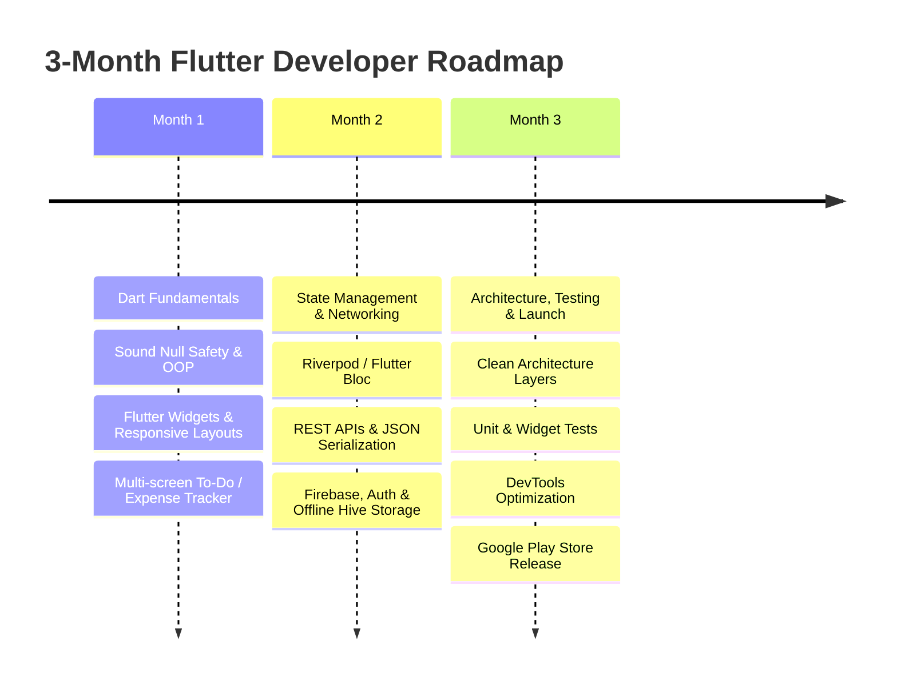

# 📱 3-Month Flutter & Dart Mastery Roadmap

[⬅️ Return to Main Directory](../README.md)

A structured, zero-fluff, 12-week comprehensive roadmap engineered to take you from core Dart fundamentals and UI layouts to advanced state management, cloud backends, testing, clean architecture, and app store deployment.

---

## 🧭 High-Level Roadmap Overview

---

## 🗓️ Month-by-Month Breakdown

### 🎯 Month 1: Dart Fundamentals & UI Layouts
> *Flutter is only as solid as your understanding of Dart. Do not rush this month.*

#### ⏱️ Weeks 1–2: Dart Programming Proper
- **Core Concepts:**
  - Variables, types (`int`, `double`, `String`, `bool`).
  - Functions, control flow (loops and conditionals).
  - Object-Oriented Programming (Classes, constructors, mixins, inheritance).
- **Advanced Dart:**
  - Sound null safety (`?`, `!`, `late`).
  - Collections (`List`, `Map`, `Set`) & collection operators.
  - Asynchronous programming (`async`, `await`, `Future`, `Stream`).
- **Best Resources:**
  - 📖 [Dart Official Documentation & Tour](https://dart.dev/)
  - 🎥 [The Net Ninja Dart Tutorial (YouTube)](https://www.youtube.com/playlist?list=PL4cUxeGkcC9iVGY3ppchN9kIauln8IiEh)

#### ⏱️ Weeks 3–4: Flutter Widgets, Layouts & Navigation
- **Core Concepts:**
  - Stateless vs. Stateful widgets lifecycle.
  - Layout building blocks (`Row`, `Column`, `Stack`, `ListView`, `GridView`).
  - Forms, user inputs, and field validations.
  - Responsive layouts across different screen sizes.
- **Navigation:**
  - Screen routing using `go_router` or Flutter's native Navigator 2.0.
- **🛠️ Mini-Project:**
  - Build a fully responsive **To-Do / Expense Tracker App** with local state (`setState`) and multiple screens.

---

### ⚡ Month 2: State Management, Networking & Backend Integration
> *Moving beyond single-screen apps to connect with the internet and maintain persistent states.*

#### ⏱️ Weeks 5–6: State Management (Riverpod or Bloc)
- **Core Concepts:**
  - Why `setState` fails in large, production apps.
  - Master a professional state management library: **Riverpod** or **Flutter Bloc** (industry standards).
  - Clear separation of UI presentation from business logic.
- **Best Resources:**
  - 📖 [Official Riverpod Documentation](https://riverpod.dev/)
  - 📖 [Reso Coder’s Flutter Bloc Tutorials](https://resocoder.com/)

#### ⏱️ Week 7: REST APIs & JSON Parsing
- **Core Concepts:**
  - Making HTTP network calls using the `http` or `dio` package.
  - Handling asynchronous UI states (**Loading**, **Success**, **Error**).
  - Parsing JSON safely into Dart data models (`json_serializable` / `freezed`).
- **🛠️ Mini-Project:**
  - Build a **Live Weather App** or a **Crypto Tracker App** fetching real-time data from a public REST API.

#### ⏱️ Week 8: Firebase & Local Storage
- **Core Concepts:**
  - Connecting your app to Firebase:
    - Authentication (Email/Password, Google Sign-In).
    - Cloud Firestore for real-time NoSQL databases.
  - Local caching and persistence using **Hive** or **SharedPreferences**.
- **🛠️ Mini-Project:**
  - Build a real-time **Chat Application** with user authentication and cloud storage.

---

### 🚀 Month 3: Architecture, Polish, Testing & Deployment
> *Transforming code into a professional product ready for a portfolio or app stores.*

#### ⏱️ Week 9: Clean Architecture & Local Polish
- **Core Concepts:**
  - Structuring code into clean layers: **Presentation**, **Domain**, and **Data**.
  - Adding smooth micro-interactions and explicit/implicit animations.
  - Custom app themes using **Material 3**.
  - Handling edge cases like offline connectivity and network retries.

#### ⏱️ Week 10: Testing & Debugging
- **Core Concepts:**
  - Writing **Unit Tests** for business logic and state managers.
  - Writing **Widget Tests** for UI components and user interaction flows.
  - Mastering **Flutter DevTools** (Profiler, Network Inspector, Widget Inspector) to resolve performance hitches and fix `RenderFlex` overflow errors.

#### ⏱️ Weeks 11–12: The Capstone Project & Publishing
- **🎓 The Capstone Project:**
  - Build an original, full-stack application combining APIs, local storage, state management, and clean UI architecture.
  - Push everything cleanly to GitHub with a descriptive, production-grade `README.md`.
- **📦 Deployment:**
  - Generate signing keys and configure your app bundle (`app-release.aab`).
  - Learn how to publish internally or publicly to the **Google Play Store**.

---

## 📋 Quick Copy-Paste Weekly Checklist

| Week | Focus Area | Key Deliverable / Project |
| :---: | :--- | :--- |
| **Weeks 1–2** | **Dart Language Basics** | Console utilities & understanding OOP / Null safety |
| **Weeks 3–4** | **Flutter UI & Layouts** | Multi-screen static app with custom widgets & forms |
| **Weeks 5–6** | **State Management (Riverpod / Bloc)** | Refactoring apps to handle shared global state cleanly |
| **Week 7** | **REST APIs & Parsing** | Weather / Crypto app pulling live data with model serialization |
| **Week 8** | **Firebase & Local Storage** | Authenticated chat or notes app with cloud sync & local cache |
| **Weeks 9–10** | **Architecture & Testing** | Clean Architecture folder structure + Unit & Widget tests |
| **Weeks 11–12** | **Capstone & Deployment** | Polished portfolio app on GitHub & published to Google Play |

---

Maintained by [DNRaina](https://github.com/DNRaina)

