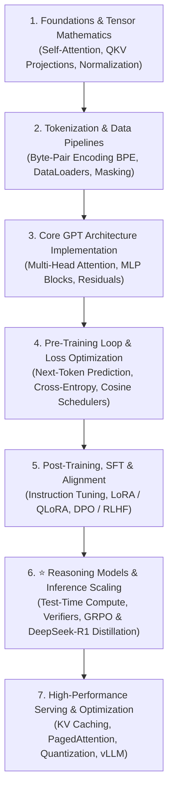

# 🧠 Large Language Models & Reasoning Models From Scratch (2026 Edition)

[⬅️ Return to Main Directory](../README.md)

[](https://www.youtube.com/@dhruvnarayanraina)
[](https://pytorch.org/)
[-8A2BE2?style=for-the-badge)](#-must-track-building-reasoning-models-from-scratch-sebastian-raschka)
[](#-preferable-track-build-a-large-language-model-from-scratch-sebastian-raschka)
[](../LICENSE)

A rigorous, zero-fluff, production-grade roadmap and curriculum engineered to take you from foundational neural network mathematics to writing complete GPT architectures line-by-line in pure PyTorch, pretraining, fine-tuning (SFT, LoRA, DPO), and mastering **Large Reasoning Models (LRMs)** with Test-Time Compute, Inference Scaling, GRPO (DeepSeek-R1 style RLVR), and distillation.

---

## 🧭 High-Level Engineering Roadmap



---

## 🏛️ The Curated Learning Tracks Overview

| Track Focus | Core Source / Creator | YouTube Link | Companion Repository |
| :--- | :--- | :--- | :--- |
| **⭐ MUST TRACK: Reasoning Models** | **Sebastian Raschka** | [▶️ Reasoning From Scratch Playlist](https://www.youtube.com/playlist?list=PLfrHAQCRxtUs) | [`rasbt/reasoning-from-scratch`](https://github.com/rasbt/reasoning-from-scratch) |
| **⭐ PREFERABLE TRACK: LLMs From Scratch** | **Sebastian Raschka** | [▶️ Build an LLM Playlist](https://www.youtube.com/playlist?list=PLTKMiZHVd_2IIEsoJrWACkIxLRdfMlw11) | [`rasbt/LLMs-from-scratch`](https://github.com/rasbt/LLMs-from-scratch) |
| **🔄 ALTERNATIVE TRACK: Deep Dive (43 Lectures)** | **Vizuara** | [▶️ Building LLMs from Scratch Playlist](https://www.youtube.com/playlist?list=PLPTV0NXA_ZSgsLAr8YCgCwhPIJNNtexWu) | `Vizuara AI Curriculum` |
| **🔬 HIGH-LEVEL ARCHITECTURES: Math & PyTorch** | **Umar Jamil** | [▶️ Umar Jamil Channel Videos](https://www.youtube.com/@umarjamilai/videos) | [`hkproj/pytorch-transformer`](https://github.com/hkproj/pytorch-transformer) |

---

## 🚀 ⭐ MUST TRACK: Building Reasoning Models From Scratch (Sebastian Raschka)

> *The modern frontier of LLMs (OpenAI o1/o3, DeepSeek-R1). Transitioning from System 1 (fast, pattern matching) to System 2 (deliberative, multi-step chain-of-thought verification, inference scaling, and reinforcement learning).*

```
Base LLM  ──▶  KV-Cached Decoding  ──▶  Rule-Based Verifiers  ──▶  GRPO / RLVR  ──▶  Distilled Reasoning SLM
```

- **Core Paradigm Shift:** Traditional autoregressive models generate the most probable next token; reasoning models trade inference compute (time and token budgets) to search, plan, backtrack, self-correct, and verify intermediate thought traces before yielding final answers.
- **Key Concepts:**
  - **Inference-Time Scaling:** Temperature, Top-p, Self-Consistency (majority voting across diverse sample paths), Logprob Scoring, and Self-Refinement loops.
  - **Verifiable Rewards (RLVR):** Constructing automated programmatic verifiers (exact math solutions, unit-test execution for code) to eliminate human-in-the-loop reward models.
  - **Group Relative Policy Optimization (GRPO):** DeepSeek-R1's breakthrough algorithm — sampling groups of outputs per prompt, computing advantage scores normalized across the group, and penalizing drift with KL divergence terms without requiring a critic model.
  - **Reasoning Distillation:** Generating on-policy/off-policy reasoning traces from large frontier models to fine-tune compact Small Language Models (1.5B–7B parameters) with high reasoning density.

### 🎬 Complete Lecture Breakdown & Direct Video Links

| # | Video Title | Runtime | Direct Video Link | Key Concepts Covered |
| :---: | :--- | :---: | :---: | :--- |
| **01** | **Motivation & Code Setup** | ~43 min | [Watch Video](https://www.youtube.com/watch?v=Kh9mqTzjuEQ) | Environment setup (`uv`, PyTorch), reasoning paradigms, System 1 vs. System 2 thinking |
| **02** | **Loading a Base Model, Generation & KV Caching** | ~1 hr 08 min | [Watch Video](https://www.youtube.com/watch?v=BJua0yjO5dk) | Pre-trained weights, generation loops, and optimizing decoding speed with Key-Value (KV) Caching |
| **03** | **The Verifier for Evaluation & RL with Verifiable Rewards** | ~50 min | [Watch Video](https://www.youtube.com/watch?v=JQJ_8_jSAoY) | Rule-based verifiers (GSM8k, MATH), ground truth verification, eliminating RM reward hacking |
| **04** | **Inference Scaling 1: Temperature, Top-p, Self-Consistency** | ~1 hr 02 min | [Watch Video](https://www.youtube.com/watch?v=t5y-kS9nNxU) | Parallel path generation, exploration vs. exploitation, majority voting over reasoning chains |
| **05** | **Inference Scaling 2: Logprob Scoring & Self-Refinement** | ~1 hr 15 min | [Watch Video](https://www.youtube.com/watch?v=TVMyOJ_3Gxo) | Cumulative log-probability ranking, multi-turn self-correction loops, critique-and-refine prompts |
| **06** | **Reinforcement Learning 1: Implementing GRPO for RLVR** | ~1 hr 18 min | [Watch Video](https://www.youtube.com/watch?v=237Hf7Q3lgg) | DeepSeek-R1 style Group Relative Policy Optimization, group advantage normalization, coding RL loop |
| **07** | **Reinforcement Learning 2: Tracking, KL Terms & Stability** | ~1 hr 10 min | [Watch Video](https://www.youtube.com/watch?v=VxfUrUrrczs) | KL divergence penalties, reference policy freezing, entropy tracking, reward collapse prevention |
| **08** | **Distillation: Distilling Reasoning into Compact Models** | ~58 min | [Watch Video](https://www.youtube.com/watch?v=msp69FR5NZs) | Soft vs. hard distillation, curated reasoning datasets, fine-tuning small models (Qwen-2.5/Llama-3) |

---

## 📘 ⭐ PREFERABLE TRACK: Build a Large Language Model From Scratch (Sebastian Raschka)

> *The definitive, hands-on PyTorch coding journey. Implement every single component of a GPT-style autoregressive model from raw Python primitives to pretraining and alignment.*

- **Companion Code Repository:** [github.com/rasbt/LLMs-from-scratch](https://github.com/rasbt/LLMs-from-scratch)
- **Primary Goal:** Demystify how tokens become tensors, how causal attention shields future context, how transformer blocks propagate gradients, and how raw weights become an instruction-following assistant.

### 🎬 Complete Lecture Breakdown & Direct Video Links

| # | Video Title | Direct Video Link | Key Implementation Milestones |
| :---: | :--- | :---: | :--- |
| **01** | **Set up your code environment** | [Watch Video](https://www.youtube.com/watch?v=yAcWnfsZhzo) | Python virtual environments, PyTorch GPU verification, CUDA configuration |
| **02** | **Working with text data** | [Watch Video](https://www.youtube.com/watch?v=341Rb8fJxY0) | Tokenization, vocabulary construction, Byte Pair Encoding (BPE), token & positional embeddings |
| **03** | **Coding attention mechanisms** | [Watch Video](https://www.youtube.com/watch?v=-Ll8DtpNtvk) | Simplified attention, Query-Key-Value matrices, Causal attention masking, Multi-Head Attention |
| **04** | **Implementing a GPT model from Scratch** | [Watch Video](https://www.youtube.com/watch?v=YSAkgEarBGE) | LayerNorm, GELU activations, feed-forward sublayers, residual skip connections, GPT-2 architecture |
| **05** | **Pretraining on Unlabeled Data** | [Watch Video](https://www.youtube.com/watch?v=Zar2TJv-sE0) | Next-token prediction loss, Cross-Entropy, DataLoader sliding window, text generation loop |
| **06** | **Finetuning for Classification** | [Watch Video](https://www.youtube.com/watch?v=5PFXJYme4ik) | Replacing the final language model head, fine-tuning pre-trained weights for text/spam classification |
| **07** | **Instruction Finetuning** | [Watch Video](https://www.youtube.com/watch?v=4yNswvhPWCQ) | Instruction-response formatting, Alpaca prompt templates, masked target loss, conversational tuning |

---

## 📺 🔄 ALTERNATIVE TRACK: Building LLMs From Scratch (Vizuara)

> *A complete 43-lecture blackboard-to-code masterclass. Ideal if you want granular, first-principles mathematical derivations paired with modular Python implementations.*

- **Full Series Link:** [▶️ Building LLMs from scratch Playlist](https://www.youtube.com/playlist?list=PLPTV0NXA_ZSgsLAr8YCgCwhPIJNNtexWu)

### 📌 Key Thematic Lecture Clusters

- **Tokenization & Data Pipelines (Lectures 7–12):**
  - [Lec 7: Code a Tokenizer from Scratch](https://www.youtube.com/watch?v=rsy5Ragmso8) &bull; [Lec 8: Byte Pair Encoding (BPE)](https://www.youtube.com/watch?v=fKd8s29e-l4) &bull; [Lec 9: PyTorch DataLoader Batches](https://www.youtube.com/watch?v=iQZFH8dr2yI) &bull; [Lec 10: Token Embeddings](https://www.youtube.com/watch?v=ghCSGRgVB_o) &bull; [Lec 11: Positional Embeddings](https://www.youtube.com/watch?v=ufrPLpKnapU)
- **Attention Mechanics Deep Dive (Lectures 13–18):**
  - [Lec 13: Attention Mechanism Introduction](https://www.youtube.com/watch?v=XN7sevVxyUM) &bull; [Lec 14: Simplified Attention (No Weights)](https://www.youtube.com/watch?v=eSRhpYLerw4) &bull; [Lec 15: Q, K, V Matrices](https://www.youtube.com/watch?v=UjdRN80c6p8) &bull; [Lec 16: Causal Masked Attention](https://www.youtube.com/watch?v=h94TQOK7NRA) &bull; [Lec 17–18: Multi-Head Attention Code & Mathematics](https://www.youtube.com/watch?v=K5u9eEaoxFg)
- **Transformer Block & GPT Architecture (Lectures 19–25):**
  - [Lec 19: Architecture Bird's Eye View](https://www.youtube.com/watch?v=4i23dYoXp-A) &bull; [Lec 20: Layer Normalization](https://www.youtube.com/watch?v=G3W-LT79LSI) &bull; [Lec 21: GELU Activations](https://www.youtube.com/watch?v=d_PiwZe8UF4) &bull; [Lec 23: Complete Transformer Block](https://www.youtube.com/watch?v=dvH6lFGhFrs) &bull; [Lec 24: 124M GPT-2 Architecture](https://www.youtube.com/watch?v=G3-JgHckzjw)
- **Training, Loss & Sampling (Lectures 26–32):**
  - [Lec 26: Measuring LLM Loss](https://www.youtube.com/watch?v=7TKCrt--bWI) &bull; [Lec 28: Pre-training Loop in Python](https://www.youtube.com/watch?v=Zxf-34voZss) &bull; [Lec 29: Temperature Scaling](https://www.youtube.com/watch?v=oG1FPVnY0pI) &bull; [Lec 30: Top-k Sampling](https://www.youtube.com/watch?v=EhU32O7DkA4) &bull; [Lec 32: Loading Pretrained OpenAI GPT-2 Weights](https://www.youtube.com/watch?v=yXrGeDNuymY)
- **Fine-Tuning & Evaluation (Lectures 33–43):**
  - [Lec 33: Fine-Tuning Foundations](https://www.youtube.com/watch?v=yZpy_hsC1bE) &bull; [Lec 36: Classification Fine-Tuning](https://www.youtube.com/watch?v=0PpxZ3kNPWo) &bull; [Lec 37: Instruction Tuning (Alpaca)](https://www.youtube.com/watch?v=1bLhvqZzdaQ) &bull; [Lec 41: Instruction Fine-Tuning Loop](https://www.youtube.com/watch?v=r7unILsP0Es) &bull; [Lec 42: Model Evaluation with Ollama](https://www.youtube.com/watch?v=7m2jV7BOFkA)

---

## 🔬 📐 HIGH-LEVEL ARCHITECTURAL DEEP DIVES: Umar Jamil

> *For advanced practitioners seeking uncompromising mathematical clarity paired with modular, production-standard PyTorch code written line-by-line from scratch.*

- **Channel Link:** [📺 Umar Jamil YouTube Channel](https://www.youtube.com/@umarjamilai/videos)

### 🏆 Essential Umar Jamil Masterclasses

1. [**Attention Is All You Need — Coding the Original Transformer**](https://www.youtube.com/watch?v=ISNdQcPhsts)
   - Complete encoder-decoder implementation with sinusoidal positional encodings, scaled dot-product attention, multi-head projection layers, and training on an English-to-Italian translation dataset.
   - Code: [`hkproj/pytorch-transformer`](https://github.com/hkproj/pytorch-transformer)
2. [**LLaMA Explained & Coded from Scratch in PyTorch**](https://www.youtube.com/watch?v=oM4VmoabDAI)
   - Deep dive into state-of-the-art open-weight LLM architectures: Rotary Positional Embeddings (RoPE), RMSNorm (Root Mean Square Normalization), SwiGLU activation functions, and KV Cache inference.
3. [**LoRA: Low-Rank Adaptation of LLMs Coded from Scratch**](https://www.youtube.com/watch?v=PXERUn244z8)
   - Implementing parameter-efficient fine-tuning (PEFT): decomposing $\Delta W$ into low-rank matrices $A$ and $B$ ($W = W_0 + \frac{\alpha}{r} B A$), drastically cutting trainable parameters while preserving base model knowledge.
4. [**Stable Diffusion From Scratch in PyTorch**](https://www.youtube.com/watch?v=ZbkpAp_6Tzs)
   - Implementing Variational Autoencoders (VAE), CLIP text embeddings, and UNet with Cross-Attention for text-to-image diffusion.

---

## 🧩 Comprehensive Module-by-Module Technical Curriculum

### 📦 Module 1: Foundational Mathematics & Tensor Operations
- **Matrix Calculus for Transformers:** Understanding Jacobian and gradient propagation through matrix multiplications.
- **Attention Mechanics:**
  $$\text{Attention}(Q, K, V) = \text{softmax}\left(\frac{Q K^T}{\sqrt{d_k}}\right) V$$
- **Multi-Head Projection:** Projecting inputs into $h$ distinct representation subspaces to attend simultaneously to syntactic and semantic dependencies.
- **Normalization Techniques:**
  - **LayerNorm:** Normalizing across features with learnable $\gamma$ and $\beta$.
  - **RMSNorm:** Eliminating mean computation for faster inference without performance degradation.
- **Positional Encoding Strategies:**
  - Learnable vs. Sinusoidal absolute positional encodings.
  - Rotary Position Embeddings (RoPE): Rotating query and key vectors in complex plane to encode relative token distances directly into attention scores.

---

### 📦 Module 2: Data Preprocessing, Tokenization & Architecture Assembly
- **Tokenization:**
  - Subword vocabulary building with Byte Pair Encoding (BPE).
  - Special tokens (`<|endoftext|>`, `<|im_start|>`, `<|im_end|>`).
- **DataLoaders & Batching:**
  - Sliding context windows with stride parameters.
  - Padding, attention masks, and dynamic sequence bucketing.
- **The GPT Architecture:**
  - Causal masking via upper-triangular masking ($-\infty$ prior to softmax).
  - Multi-Layer Perceptron (MLP) blocks with GELU / SwiGLU activations.
  - Pre-layer normalization vs. Post-layer normalization stability.
  - Residual skip connections to mitigate vanishing gradients in 24+ layer transformers.

---

### 📦 Module 3: Pre-Training & Post-Training Alignment
- **Autoregressive Pre-Training:**
  - Objective: Minimizing Cross-Entropy Loss over next-token predictions:
    $$\mathcal{L} = -\sum_{t=1}^{T} \log P(x_t \mid x_{<t}; \theta)$$
  - AdamW optimizer, weight decay, gradient accumulation, and learning rate warm-up with cosine annealing.
- **Supervised Fine-Tuning (SFT):**
  - Formatting datasets with system, user, and assistant roles.
  - Masking prompt tokens from loss calculation (computing loss exclusively on assistant response tokens).
- **Parameter-Efficient Fine-Tuning (PEFT):**
  - Implementing LoRA adapters on Query, Key, Value, and Output projection layers.
  - QLoRA: Double quantization, 4-bit NormalFloat (NF4), and paged optimizers for fine-tuning on consumer GPUs.
- **Preference Alignment (DPO vs. RLHF):**
  - Direct Preference Optimization (DPO): Bypassing unstable reward model training by directly optimizing the policy using implicit reward modeling on chosen vs. rejected response pairs.

---

### 📦 Module 4: ⭐ Advanced Reasoning Models & Inference Scaling
- **Test-Time Compute Expansion:**
  - Why scaling pretraining parameters hits diminishing returns, and why inference computation is the new frontier.
  - Tree-of-Thoughts (ToT) and Monte Carlo Tree Search (MCTS) exploration over token generation branches.
- **Verification & Outcome Rewards:**
  - Automated verifiers for deterministic tasks (math theorem proving, competitive programming, regex, structured JSON schema validation).
- **GRPO (Group Relative Policy Optimization):**
  - Sample $G$ responses $\{o_1, o_2, \dots, o_G\}$ for prompt $q$.
  - Compute verifier rewards $\{r_1, r_2, \dots, r_G\}$.
  - Standardize rewards to compute relative advantages:
    $$A_i = \frac{r_i - \text{mean}(r)}{\text{std}(r) + \epsilon}$$
  - Optimize the policy objective with clipped surrogate objectives and KL penalty to prevent policy degradation.
- **Reasoning Distillation:**
  - Filtering synthetic traces: preserving `<think> ... </think>` tokens containing explicit chain-of-thought verification steps.
  - Distilling into 1.5B–7B parameter SLMs to achieve frontier reasoning scores at low inference costs.

---

### 📦 Module 5: High-Throughput Serving & Production Optimization
- **Key-Value (KV) Caching:**
  - Eliminating redundant re-computation of historical keys and values during token-by-token generation: caching $K$ and $V$ tensors across decoding steps.
- **Memory Management & PagedAttention:**
  - Addressing GPU memory fragmentation with virtual paging (vLLM architecture).
- **Quantization:**
  - Post-Training Quantization (PTQ): AWQ (Activation-aware Weight Quantization), GPTQ, and GGUF quantization formats.
- **Retrieval-Augmented Generation (RAG):**
  - Chunking strategies, dense embeddings, vector indexing (HNSW), semantic rerankers (Cross-Encoders), and citation grounding.

---

## 📋 Recommended Implementation Milestones

| Stage | Milestone Project | Target Tech Stack | Verification / Deliverable |
| :---: | :--- | :--- | :--- |
| **Stage 1** | **BPE Tokenizer & DataLoader** | Pure Python, Regex, PyTorch | Encode/decode custom text, verify batch shapes `(B, T)` |
| **Stage 2** | **Causal Multi-Head Attention** | PyTorch `nn.Module` | Verify causal masking prevents information leakage |
| **Stage 3** | **Full 124M GPT Architecture** | PyTorch, NumPy | Match official GPT-2 parameter count and forward pass outputs |
| **Stage 4** | **Pretraining & Generation Loop** | PyTorch, AdamW, CUDA | Train on small corpus (TinyStories/Shakespeare) to produce coherent text |
| **Stage 5** | **Instruction Tuning & LoRA** | PyTorch, Hugging Face Datasets | Adapt model to follow user instructions in formatted conversation style |
| **Stage 6** | **⭐ Reasoning Verifier & GRPO** | PyTorch, Math Verifier Script | Implement group-relative rewards; observe model generating `<think>` reasoning traces |
| **Stage 7** | **KV-Cached Fast Inference** | PyTorch, CUDA | Benchmark token generation throughput with vs. without KV cache |

---

<div align="center">

Maintained by [DNRaina](https://github.com/DNRaina)

</div>
